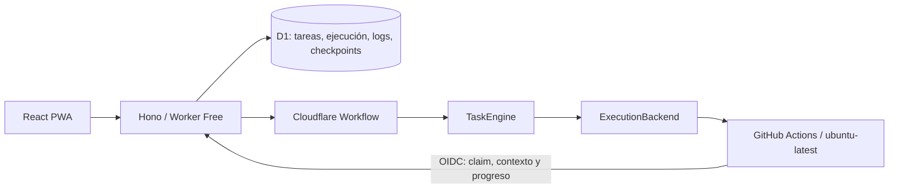

# Primera vertical durable

## Componentes

La solicitud crea Task y Execution mediante un batch D1. Un outbox persistido
registra las ejecuciones cuyo Workflow todavía falta. La API intenta crearlo y un
cron cada cinco minutos reconcilia pendientes. El cliente no es un scheduler.

Cada ejecución tiene un Workflow identificado por executionId y número de intento
de orquestación. TaskEngine depende de ExecutionBackend y TaskRepository, no de
Cloudflare ni de GitHub. El adaptador Workflows traduce pasos y sleeps durables.

GitHubActionsExecutionBackend implementa start, cancel y getStatus. Dispatch utiliza
un identificador opaco; el runner recupera input y checkpoint desde Cubo mediante
OIDC. GitHub puede aceptar el dispatch sin devolver run_id. Se correlaciona con
run-name exacto y después con el run_id reclamado de forma atómica en D1.

## Ejecución efímera

El runner demostrativo suma cuadrados en seis pasos de diez segundos. Guarda cada
paso en D1. Su estado de proceso no es la fuente de verdad. Al finalizar, el resultado
queda persistido y el runner termina.

Si se solicita pausa, el checkpoint y aprobación pendiente se guardan juntos con
WAITING_APPROVAL. El runner termina y el Workflow deja de esperar. La aprobación de
continuación crea otra Execution; el nuevo runner recupera cursor y suma del checkpoint.
La aprobación está vinculada al digest, ejecución y versión de la tarea.

Esta aprobación permite continuar la demo. No autoriza cambios de GitHub. No hay
funcionalidades de commit, push o PR en esta vertical y el runner no conserva
credenciales de Git ni recibe el PAT del control plane.

## Recuperación e idempotencia

- Una clave UUID estable evita duplicar tareas al repetir el POST.
- Outbox cubre la interrupción entre D1 y la creación del Workflow.
- Workflows persiste sus pasos y reintenta operaciones externas.
- La reclamación de run_id impide que dos dispatches ejecuten efectos para una misma ejecución.
- Checkpoints y eventos tienen claves deterministas y validan orden, contenido y estado.
- Una actualización tardía no reemplaza el resultado o una ejecución posterior.
- El callback de progreso confirma una transacción D1 antes de que el runner avance.

No existe una transacción entre GitHub y D1. Un dispatch cuya respuesta se pierde
puede producir un runner duplicado; la reclamación evita efectos duplicados, pero
ese runner puede consumir minutos gratuitos. No se promete exactamente un dispatch.
Esta limitación debe tenerse en cuenta al incorporar agentes con efectos externos.

## Seguridad y datos

Worker autentica al propietario mediante una cookie HttpOnly/SameSite firmada, con
clave y secreto solo en el backend. Los callbacks validan firma OIDC, issuer,
audience, repo, rama, workflow, evento y run_id. El cliente no puede escribir progreso.

El runner usa contents: read e id-token: write. No usa checkout con credenciales
persistidas. Node 24 ejecuta TypeScript sin instalación de dependencias en Actions.
Las entradas de dispatch pasan por variables de entorno; no se interpolan en shell.

D1 almacena registros pequeños. JSON de callbacks limitado a 8 KiB; demo de 2 a 12
pasos, con tiempos acotados. Los archivos grandes, repositorios y checkpoints completos
de agentes requieren diseño posterior dentro del presupuesto cero. No se activa R2.

## Límites de la vertical

Máximo de 20 tareas nuevas por día y 3 tareas en cola/ejecución. Cada Workflow observa
durante un máximo de 15 minutos y cada job tiene timeout de 10 minutos. La cola de
GitHub puede tardar más que ese plazo; entonces la tarea falla de forma explícita.
No hay SLA de inicio ni una promesa de ejecución ilimitada en tiers gratuitos.

Agents, Providers, Project y permisos de repositorio son contratos para próximos
hitos. La demo no invoca Codex, OpenCode ni APIs de modelos.

